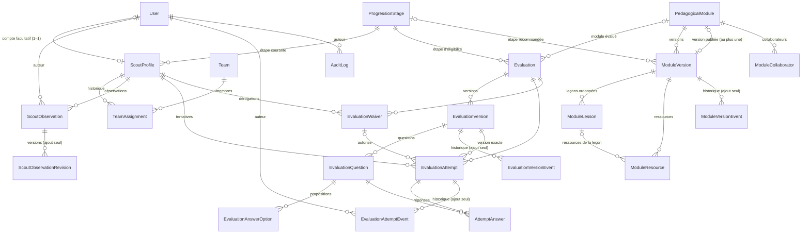

# Base de données

PostgreSQL 18 (Docker Compose en développement) · Prisma 7 avec `@prisma/adapter-pg` · schéma : `apps/api/prisma/schema.prisma`.

## Modèles actuels

| Modèle (table) | Rôle | Points notables |
| --- | --- | --- |
| `User` (`users`) | Compte de connexion | `email` unique (minuscules), `role` (`ROUTIER`/`CHEF`/`RESPONSABLE`), `passwordHash` (Argon2id) nullable = compte non activé, `lastLoginAt`, jamais supprimé (`isActive`) |
| `Session` (`sessions`) | Session serveur | Seul `tokenHash` (SHA-256 du jeton du cookie) est stocké ; `expiresAt` (durée absolue `SESSION_TTL_HOURS`), `revokedAt` (déconnexion), `lastUsedAt` ; supprimée avec l'utilisateur (`Cascade`) |
| `ScoutProfile` (`scout_profiles`) | **Profil routier** (référence métier) | `userId` **facultatif** et unique ; `firstName`, `lastName` ; `matricule` facultatif, unique, forme normalisée (CHECK) ; `joinedAt`, `birthDate`, `currentStageId` ; `isActive` (désactivation sans suppression) |
| `ScoutObservation` (`scout_observations`) | Observation d'accompagnement | `scoutProfileId` (profil), `authorId`, `observedOn`, `content`, `category` (libellé libre facultatif), `visibility` (`ENCADREMENT`/`RESPONSABLE`), `editedAt` ; jamais supprimée ; routier, auteur et date de saisie immuables (trigger) |
| `ScoutObservationRevision` (`scout_observation_revisions`) | Historique des modifications d'une observation | État **précédent** à chaque modification (`editorId`, contenu, catégorie, visibilité, date) ; ajout seul (trigger) |
| `ProgressionStage` (`progression_stages`) | Référentiel des étapes | `code` et `position` uniques ; alimenté par le seed |
| `Team` (`teams`) | Équipe de la communauté | `name` unique ; archivage par `archivedAt` (jamais supprimée) |
| `TeamAssignment` (`team_assignments`) | Historique des affectations | `startedAt`, `endedAt` (null = en cours), `assignedById`, `endedById` ; une seule affectation ouverte par routier ; périodes sans chevauchement |
| `Evaluation` (`evaluations`) | Évaluation (questionnaire stable) | `number` (code `EVAL-NNN`), `title` (titre publié), `stageId` (étape d'éligibilité) et `moduleId` facultatif, figés après la première publication ; `createdById` ; `publishedVersionId` (au plus une version publiée) |
| `EvaluationVersion` (`evaluation_versions`) | Version d'un questionnaire | `(evaluationId, version)` unique ; `status` (mêmes états que les modules), `title`, `instructions`, `durationMinutes`, `maxAttempts`, `revision` ; auteurs et dates de soumission, approbation, publication, archivage ; `moduleVersionId` (version du module en vigueur à la publication). Colonnes JSON `questions`/`answerKey` de la phase 1 bis conservées (historique), plus utilisées |
| `EvaluationQuestion` (`evaluation_questions`) | Question | `versionId`, `position`, `type` (`QuestionType`), `prompt` (texte brut), `points` (DECIMAL 6,2), `scoringPolicy`, `guidance` (critères), `expectedAnswer`, `revision` |
| `EvaluationAnswerOption` (`evaluation_answer_options`) | Proposition de réponse | `questionId`, `position`, `label`, `isCorrect` (corrigé : jamais transmis au routier avant examen) |
| `EvaluationVersionEvent` (`evaluation_version_events`) | Historique des questionnaires | Ajout seul : action, états, auteur, commentaire (décisions du responsable également dans `AuditLog`) |
| `EvaluationAttempt` (`evaluation_attempts`) | Tentative (en ligne, hors ligne, papier) | `code` unique et immuable ; `scoutProfileId` (profil, pas compte) ; version exacte (FK composite `(evaluationVersionId, evaluationId)`) ; `mode`, `status` ; `plannedFor`, `startedAt`, `submittedAt`, `completedAt`, `recordedAt`, `correctionRevision` ; `score`, `maxScore` (calculés), `answers` (JSON phase 1 bis, conservé), `maxScore`, `observations`, `evidenceFileKey` ; auteurs (`createdById`, `recordedById`, `decidedById`) ; `waiverId` ; annulation motivée ; réservation hors ligne (`offline*`, phase 5) |
| `AttemptAnswer` (`attempt_answers`) | Réponse et correction | `(attemptId, questionId)` unique ; `selectedOptionIds`, `textAnswer` ; `awardedPoints`, `autoScored` ; `appreciation`, `graderComment`, `gradedById`, `gradedAt` |
| `EvaluationAttemptEvent` (`evaluation_attempt_events`) | Historique d'une tentative | Ajout seul (trigger) : `fromStatus`, `toStatus`, `actorId`, `reason`, `snapshot` (valeurs saisies) |
| `AttemptCodeCounter` (`attempt_code_counters`) | Compteur annuel des codes | `year` (PK), `lastValue` (1 à 999 999) |
| `EvaluationWaiver` (`evaluation_waivers`) | Dérogation (déblocage individuel) | `reason`, `grantedById`, `grantedAt`, `expiresAt`, `revokedAt`, `revokedById`, `revocationReason` |
| `PedagogicalModule` (`pedagogical_modules`) | Module pédagogique | `number` (SERIAL, code `MOD-001`), `slug` unique et stable, `createdById`, `publishedVersionId` (unique, nullable : version en ligne) |
| `ModuleVersion` (`module_versions`) | Version éditoriale | `(moduleId, version)` unique ; `status` (`ModuleVersionStatus`) ; titre, `summary`, `objectives` (text[]), `prerequisites`, `durationMinutes`, `stageId` (étape recommandée), `theme` (libellé libre) ; `revision` (concurrence optimiste) ; `basedOnVersionId` ; auteurs et dates de soumission, approbation, publication, archivage ; `submissionNote` |
| `ModuleLesson` (`module_lessons`) | Leçon ordonnée | `versionId`, `position` (0…n, contiguë), `title`, `content` (JSONB validé par liste blanche), `durationMinutes`, `revision`, `createdById`, `updatedById` |
| `ModuleResource` (`module_resources`) | Ressource externe | `versionId`, `lessonId` (null = module), `kind` (`IMAGE`, `DOCUMENT`, `VIDEO`, `LIEN`), `title`, `url`, `description` |
| `ModuleCollaborator` (`module_collaborators`) | Chef collaborateur | `moduleId`, `userId`, `addedById` ; retrait par `removedAt`/`removedById` (jamais supprimé) ; une invitation active par chef et par module |
| `ModuleVersionEvent` (`module_version_events`) | Historique des versions et décisions | Ajout seul : `action` (`ModuleVersionAction`), `fromStatus`, `toStatus`, `actorId`, `comment` |
| `AuditLog` (`audit_logs`) | Journal | Ajout seul ; `actorId` null = action système ; index `(entityType, entityId)`, `actorId`, `createdAt` |

Enums : `Role`, `ObservationVisibility` (`ENCADREMENT`, `RESPONSABLE`), `ModuleVersionStatus` (`BROUILLON`, `SOUMIS`, `A_CORRIGER`, `REFUSE`, `APPROUVE`, `PUBLIE`, `ARCHIVE`), `ModuleVersionAction` (`CREEE`, `SOUMISE`, `REPRISE`, `CORRECTIONS_DEMANDEES`, `REFUSEE`, `APPROUVEE`, `PUBLIEE`, `REMPLACEE`, `ARCHIVEE`), `ModuleResourceKind`, `EvaluationVersionStatus` et `EvaluationVersionAction` (mêmes valeurs que les modules), `QuestionType` (`CHOIX_UNIQUE`, `CHOIX_MULTIPLE`, `VRAI_FAUX`, `REPONSE_COURTE`, `REPONSE_DEVELOPPEE`), `ScoringPolicy` (`TOUT_OU_RIEN`, `CREDIT_PARTIEL`), `EvaluationMode` (`EN_LIGNE`, `HORS_LIGNE`, `PAPIER`), `AttemptStatus` (`PREPAREE`, `EN_COURS`, `A_CORRIGER`, `SOUMISE`, `VALIDEE`, `REFUSEE`, `ANNULEE`). Synchronisation avec `@tesla/shared` vérifiée par des tests.

Noms de modèles en anglais (convention du code) : `ScoutProfile` = profil routier, `Team` = équipe, `TeamAssignment` = affectation, `EvaluationAttempt` = tentative d'évaluation, `EvaluationWaiver` = dérogation. Correspondance avec les noms de la mission phase 3 : `Question` = `EvaluationQuestion`, `AnswerOption` = `EvaluationAnswerOption`, `EvaluationOverride` = `EvaluationWaiver`, `EvaluationReview` = décision portée par la tentative (`decidedById`, `decidedAt`, `decisionComment`) et son historique `EvaluationAttemptEvent`, `EvaluationAudit` = `EvaluationVersionEvent` + `AuditLog`.



## Contraintes SQL complémentaires

Ajoutées en fin de migration `20261028212208_teams_matricule_evaluation_attempts` (non exprimables dans `schema.prisma`, ignorées par le diff Prisma — absence de dérive vérifiée).

| Contrainte | Table | Effet |
| --- | --- | --- |
| `scout_profiles_matricule_format_check` | `scout_profiles` | Matricule nul ou au format officiel `^[0-9]{7}[A-Z]$` (7 chiffres + 1 lettre majuscule) : l'unicité ne peut pas être contournée par la casse ou les espaces (contrainte remplacée par la migration `20261028222140_matricule_official_format`) |
| `team_assignments_one_open_per_scout` (index unique partiel, déclaré dans Prisma) | `team_assignments` | Une seule affectation `ended_at IS NULL` par routier |
| `team_assignments_no_overlap` (EXCLUDE, extension `btree_gist`) | `team_assignments` | Aucune période d'affectation chevauchante pour un même routier |
| `team_assignments_period_check` | `team_assignments` | `ended_at > started_at` |
| `evaluation_attempts_one_open_per_scout` (index unique partiel, déclaré dans Prisma) | `evaluation_attempts` | Une tentative non clôturée par routier et par évaluation |
| `evaluation_attempts_code_format_check` | `evaluation_attempts` | Code `^NT-[0-9]{4}-[0-9]{6}$` |
| `evaluation_attempts_score_check` | `evaluation_attempts` | `0 ≤ score ≤ max_score`, `max_score > 0` |
| Trigger `evaluation_attempts_guard` | `evaluation_attempts` | Suppression interdite ; `code`, `scout_profile_id`, `evaluation_id`, `evaluation_version_id`, `mode`, `created_by_id`, `created_at` immuables |
| Trigger `evaluation_attempt_events_append_only` | `evaluation_attempt_events` | Ni mise à jour ni suppression |
| `attempt_code_counters_check` | `attempt_code_counters` | Année sur 4 chiffres, rang 1 à 999 999 |
| `evaluation_versions_version_check`, `evaluation_waivers_period_check` | — | Version > 0 ; expiration postérieure à l'attribution |
| `scout_observations_content_check` (migration `20261028230000`) | `scout_observations` | Contenu non vide ≤ 5 000 caractères ; catégorie nulle ou 1 à 80 caractères |
| Trigger `scout_observations_guard` | `scout_observations` | Suppression interdite ; `scout_profile_id`, `author_id`, `created_at` immuables |
| Trigger `scout_observation_revisions_append_only` | `scout_observation_revisions` | Ni mise à jour ni suppression |

Ajoutées en fin de migration `20261029120000_pedagogical_modules` :

| Contrainte | Table | Effet |
| --- | --- | --- |
| `module_versions_one_working_per_module` (index unique partiel) | `module_versions` | Une seule version `BROUILLON`/`SOUMIS`/`A_CORRIGER`/`APPROUVE` par module |
| `module_versions_one_published_per_module` (index unique partiel) | `module_versions` | Une seule version `PUBLIE` par module |
| `module_versions_values_check`, `module_lessons_values_check` | — | Numéro, révision, position, titre (1 à 150), durée (1 à 6 000 min), contenu JSON objet |
| `module_resources_url_check` | `module_resources` | URL `http(s)://` ≤ 2 000 caractères |
| `pedagogical_modules_slug_check` | `pedagogical_modules` | Slug `a-z0-9` séparé par des tirets, ≤ 80 |
| `module_collaborators_one_active` (index unique partiel) | `module_collaborators` | Une invitation active par chef et par module |
| Trigger `module_versions_guard` | `module_versions` | Suppression interdite ; module, numéro, auteur, origine immuables ; contenu modifiable seulement à l'état `BROUILLON` ; transitions d'état limitées au workflow |
| Trigger `module_draft_content_guard` | `module_lessons`, `module_resources` | Insertion, modification, suppression seulement dans une version `BROUILLON` ; jamais de changement de version |
| Trigger `pedagogical_modules_published_guard` | `pedagogical_modules` | Suppression interdite ; `published_version_id` désigne une version `PUBLIE` du même module |
| Trigger `module_version_events_append_only` | `module_version_events` | Ni mise à jour ni suppression |

Ajoutées en fin de migration `20261030090000_evaluation_engine` :

| Contrainte | Table | Effet |
| --- | --- | --- |
| `evaluation_versions_one_working`, `evaluation_versions_one_published` (index uniques partiels) | `evaluation_versions` | Une version de travail et une version publiée au plus par évaluation |
| `evaluation_versions_values_check`, `evaluation_questions_values_check`, `evaluation_answer_options_values_check`, `attempt_answers_values_check`, `evaluation_attempts_correction_revision_check` | — | Titre 1–150, consignes ≤ 3 000, durée 1–600 min, tentatives 1–20, énoncé 1–2 000, barème 0 < points ≤ 1 000, libellé 1–500, note ≥ 0, réponse ≤ 5 000 |
| Trigger `evaluation_versions_guard` | `evaluation_versions` | Suppression interdite ; évaluation, numéro, auteur, origine immuables ; contenu modifiable seulement en `BROUILLON` ; transitions limitées au workflow |
| Triggers `evaluation_questions_draft_guard`, `evaluation_answer_options_draft_guard` | questions, propositions | Écriture seulement dans une version `BROUILLON` ; jamais de changement de version ou de question |
| Trigger `evaluations_published_guard` | `evaluations` | Suppression interdite ; `published_version_id` désigne une version `PUBLIE` de la même évaluation |
| Trigger `attempt_answers_guard` | `attempt_answers` | Suppression interdite ; la question appartient à la version de la tentative ; écriture seulement si la tentative est `PREPAREE`, `EN_COURS` ou `A_CORRIGER` |
| Trigger `evaluation_version_events_append_only` | `evaluation_version_events` | Ni mise à jour ni suppression |

L'index unique partiel est déclaré avec la preview Prisma `partialIndexes` ; son prédicat est écrit sous la forme canonique de PostgreSQL pour éviter une fausse dérive.

## Génération des codes de tentative

`issueAttemptCode` (`apps/api/src/modules/evaluations/attempt-code.ts`) exécute, dans la transaction de création de la tentative :

```sql
INSERT INTO attempt_code_counters (year, last_value, updated_at) VALUES ($année, 1, now())
ON CONFLICT (year) DO UPDATE SET last_value = attempt_code_counters.last_value + 1, updated_at = now()
RETURNING last_value;
```

La ligne de l'année reste verrouillée jusqu'au `COMMIT` : les créations concurrentes sont sérialisées, sans boucle de collision ni dépendance au nombre de lignes. Si la transaction échoue, le rang n'a jamais été émis ; une tentative annulée conserve son code. La numérotation repart à 1 chaque année, ce qui est sûr car l'année fait partie du code. Au-delà de 999 999 tentatives par an, la contrainte CHECK bloque l'émission (aucun code ambigu).

## Conventions
- UUID v7 (`@default(uuid(7)) @db.Uuid`), tables et colonnes en snake_case.
- Dates `timestamptz(3)` en UTC ; dates calendaires en `date`.
- `onDelete` explicite ; `Restrict` par défaut.
- Client généré dans `apps/api/src/generated/prisma` (ignoré par Git, régénéré au `npm install`).

## Migrations

| Commande | Usage |
| --- | --- |
| `npm run db:migrate -- --name <nom>` | Créer et appliquer une migration (développement) |
| `npm run db:deploy` | Appliquer les migrations existantes (CI/production) |
| `npm run db:seed` | Seed idempotent : étapes de progression, programme, modules « Bases du scoutisme » ; 25 comptes de démonstration fictifs `*.demo@tesla.test` (1 responsable, `chef1`–`chef4`, `routier.demo` sans profil, `routier01`–`routier19` avec profil réparti sur les quatre étapes) uniquement hors production et si `DEMO_ACCOUNT_PASSWORD` est défini localement ; un profil existant n'est jamais modifié, aucune équipe créée |
| `npm run db:generate` | Régénérer le client |

| Migration | Contenu | Vérification |
| --- | --- | --- |
| `20261028204443_init` | 5 tables, enum `Role`, index, clés étrangères | Appliquée ; aucun `DROP` |
| `20261028212208_teams_matricule_evaluation_attempts` | Additive : identité et matricule sur `scout_profiles` (compte facultatif), équipes, affectations, évaluations, versions, tentatives, historique, compteur, dérogations, contraintes SQL | Rejouée sur une base jetable contenant un profil lié à un compte (noms repris, `user_id` conservé) puis appliquée par `db:deploy` sur la base de développement ; diff base ↔ schéma vide ; aucun `DROP` |
| `20261028230000_scout_status_observations` | Additive : `scout_profiles.is_active` (défaut `true`, profils existants conservés actifs), enum `ObservationVisibility`, tables `scout_observations` et `scout_observation_revisions`, CHECK et triggers | Appliquée sur `tesla_test` puis sur la base de développement (`db:deploy`) ; diff base ↔ schéma vide ; aucun `DROP` |
| `20261029120000_pedagogical_modules` | Additive : enums `ModuleVersionStatus`, `ModuleVersionAction`, `ModuleResourceKind` ; tables des modules, versions, leçons, ressources, collaborateurs, historique ; CHECK et triggers | Appliquée sur `tesla_test` puis sur la base de développement (`db:deploy`) ; diff base ↔ schéma vide ; aucun `DROP` |
| `20261030090000_evaluation_engine` | Additive : enums `EvaluationVersionStatus`, `EvaluationVersionAction`, `QuestionType`, `ScoringPolicy` ; colonnes de workflow sur `evaluations`/`evaluation_versions`, colonnes de passation sur `evaluation_attempts` ; tables `evaluation_questions`, `evaluation_answer_options`, `evaluation_version_events`, `attempt_answers` ; CHECK et triggers. `questions` devient nullable (aucune colonne supprimée) | Rejouée sur une base jetable contenant des versions historiques (2 publiées, 2 brouillons) : titre repris, dernière publiée `PUBLIE`, précédente `ARCHIVE`, brouillon le plus récent `BROUILLON`, ancien brouillon `REFUSE`, pointeur de publication renseigné ; puis `tesla_test` et base de développement (`db:deploy`) ; diff base ↔ schéma vide |
| `20261028222140_matricule_official_format` | Remplace la contrainte de format du matricule par le format officiel (7 chiffres + 1 lettre) ; aucune donnée modifiée, échec volontaire si un matricule existant est non conforme | Appliquée sur la base de développement (aucun matricule existant) et sur `tesla_test` ; diff vide |

Reprise de données de la migration 2 : `first_name`/`last_name` ajoutées nullables, copiées depuis `users`, puis `NOT NULL`. La table des tentatives étant créée par cette migration, aucune tentative historique sans code n'existait ; pour un futur ajout de colonne obligatoire sur des tentatives existantes, générer les valeurs (ex. codes, par ordre de `created_at`) **avant** la contrainte `NOT NULL`, sans toucher aux scores, décisions ni versions.

`migrate dev` étant refusé en environnement non interactif, le SQL a été produit par `prisma migrate diff --from-config-datasource --to-schema prisma/schema.prisma --script`, relu et complété.

Les UUID v7 sont générés par le client Prisma (pas de valeur par défaut SQL) : toute insertion SQL directe doit fournir l'`id`. Aucune migration destructive sans plan validé (voir `.claude/rules/database.md`).

## Tests d'intégration

`npm run test:int -w @tesla/api` avec `TEST_DATABASE_URL` vers une base dont le nom finit par `_test` (refus sinon). Les migrations y sont appliquées par `migrate deploy`, puis les tables sont vidées (`TRUNCATE`) avant chaque test.

## Extensions prévues (non créées)
Progression de lecture, validations officielles d'acquis et d'étape (acte du responsable référençant le profil), historique structuré des étapes (aujourd'hui : `AuditLog` `scout_profile.stage_changed`), stockage des copies numérisées, programme annuel et séances. Chacune sera ajoutée dans la phase qui l'utilise.

## Phase 4 — modèle de suivi

Migration additive `20261031090000_progression_programme_activities` : `ScoutStageChange`, `Competency`, `CompetencyModule`, `CompetencyProposal`, `CompetencyProposalEvent`, `CompetencyEvidence`, `CompetencyValidation`, `ModuleStudy`, `ProgrammeCategory`, `Programme`, `Activity`, `ActivityCategory`, `ActivityModule`, `ActivityCompetency`, `ActivityEvent`, `ActivityAttendance` ; date d’étape sur `ScoutProfile`. Références au profil, transactions, index uniques partiels et triggers d’immuabilité ; reprise de l’audit historique sans réinitialisation. Détails : [progression](FEATURES/PROGRESSION.md), [compétences](FEATURES/COMPETENCES.md), [programme annuel](FEATURES/PROGRAMME_ANNUEL.md), [activités](FEATURES/SUIVI_ACTIVITES.md), [tableaux de bord](FEATURES/DASHBOARDS.md).

## Phase 5 — réservations hors ligne

Migration additive `20261101090000_offline_reservations` (aucune donnée modifiée) : neuf colonnes nullables sur `evaluation_attempts` :

| Colonne | Rôle |
| --- | --- |
| `offline_authorization` (UUID, unique) | Autorisation opaque de la réservation |
| `offline_issued_at`, `offline_expires_at` | Émission et fin de validité (24 h) |
| `offline_operation_id` (UUID, unique) | Clé d'idempotence de la réception |
| `offline_payload_hash` | Empreinte SHA-256 de la copie reçue |
| `offline_device_submitted_at` | Heure déclarée par l'appareil (indicative) |
| `offline_received_at`, `offline_decided_at` | Réception et décision serveur |
| `offline_decision_code` | `ACCEPTED`, `ATTEMPT_CLOSED`, `AUTHORIZATION_EXPIRED`, `AUTHORIZATION_REVOKED`, `VERSION_UNAVAILABLE` |

Les index uniques garantissent qu'une autorisation et une opération ne désignent qu'une tentative. L'index partiel existant (une tentative ouverte par routier et évaluation) s'applique aussi aux réservations. Migration appliquée sur `tesla` et `tesla_test` ; diff schéma ↔ base vide.

## Import système de modules (seed pédagogique)

Migration additive `20261102090000_module_source_imports` (aucune donnée existante modifiée) :

- `created_by_id` devient facultatif sur `pedagogical_modules`, `module_versions`, `module_lessons`, et `actor_id` sur `module_version_events` : **nul = création par le système** (import d'une source), jamais attribuée à un chef ou au responsable.
- CHECK `module_version_events_system_actor_check` : un événement sans acteur ne peut être que `CREEE` ; soumission, approbation, publication, refus et archivage gardent un auteur humain.
- Table `module_source_imports` (1–1 avec le module) : code stable `source_key` unique (ex. `NT-SCOUT-M01`), document, SHA-256 et pages sources, notes éditoriales (JSON, jamais transmises aux routiers), instantané importé et empreinte canonique. **Ajout seul** (trigger `module_source_imports_append_only`).

Appliquée sur `tesla` et `tesla_test` ; diff schéma ↔ base vide. Voir [SEEDS_PEDAGOGIQUES.md](SEEDS_PEDAGOGIQUES.md).
