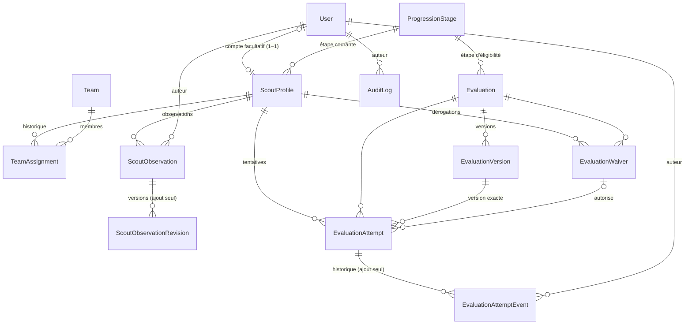

# Base de données

PostgreSQL 18 (Docker Compose en développement) · Prisma 7 avec `@prisma/adapter-pg` · schéma : `apps/api/prisma/schema.prisma`.

## Modèles actuels

| Modèle (table) | Rôle | Points notables |
| --- | --- | --- |
| `User` (`users`) | Compte de connexion | `email` unique (minuscules), `role` (`ROUTIER`/`CHEF`/`RESPONSABLE`), `passwordHash` (Argon2id) nullable = compte non activé, `lastLoginAt`, jamais supprimé (`isActive`) |
| `Session` (`sessions`) | Session serveur | Seul `tokenHash` (SHA-256 du jeton du cookie) est stocké ; `expiresAt` (durée absolue `SESSION_TTL_HOURS`), `revokedAt` (déconnexion), `lastUsedAt` ; supprimée avec l'utilisateur (`Cascade`) |
| `ScoutProfile` (`scout_profiles`) | **Profil routier** (référence métier) | `userId` **facultatif** et unique ; `firstName`, `lastName` ; `matricule` facultatif, unique, forme normalisée (CHECK) ; `joinedAt`, `birthDate`, `currentStageId` ; `isActive` (désactivation sans suppression) |
| `ScoutObservation` (`scout_observations`) | Observation d'accompagnement | `scoutProfileId` (profil), `authorId`, `observedOn`, `content`, `category` (libellé libre facultatif), `visibility` (`ENCADREMENT`/`RESPONSABLE`), `editedAt` ; jamais supprimée ; routier, auteur et date de saisie immuables (trigger) |
| `ScoutObservationRevision` (`scout_observation_revisions`) | Historique des modifications d'une observation | État **précédent** à chaque modification (`editorId`, contenu, catégorie, visibilité, date) ; ajout seul (trigger) |
| `ProgressionStage` (`progression_stages`) | Référentiel des étapes | `code` et `position` uniques ; alimenté par le seed |
| `Team` (`teams`) | Équipe de la communauté | `name` unique ; archivage par `archivedAt` (jamais supprimée) |
| `TeamAssignment` (`team_assignments`) | Historique des affectations | `startedAt`, `endedAt` (null = en cours), `assignedById`, `endedById` ; une seule affectation ouverte par routier ; périodes sans chevauchement |
| `Evaluation` (`evaluations`) | Évaluation | `title`, `stageId` (étape d'éligibilité) ; lien vers le module à ajouter en phase 2 |
| `EvaluationVersion` (`evaluation_versions`) | Version figée d'un questionnaire | `(evaluationId, version)` unique ; `questions`, `answerKey` (corrigé, jamais imprimé sur la feuille routier), `publishedAt`, `publishedById` |
| `EvaluationAttempt` (`evaluation_attempts`) | Tentative (en ligne, hors ligne, papier) | `code` unique et immuable ; `scoutProfileId` (profil, pas compte) ; version exacte (FK composite `(evaluationVersionId, evaluationId)`) ; `mode`, `status` ; `plannedFor`, `completedAt`, `recordedAt` ; `answers`, `score`, `maxScore`, `observations`, `evidenceFileKey` ; auteurs (`createdById`, `recordedById`, `decidedById`) ; `waiverId` ; annulation motivée |
| `EvaluationAttemptEvent` (`evaluation_attempt_events`) | Historique d'une tentative | Ajout seul (trigger) : `fromStatus`, `toStatus`, `actorId`, `reason`, `snapshot` (valeurs saisies) |
| `AttemptCodeCounter` (`attempt_code_counters`) | Compteur annuel des codes | `year` (PK), `lastValue` (1 à 999 999) |
| `EvaluationWaiver` (`evaluation_waivers`) | Dérogation (déblocage individuel) | `reason`, `grantedById`, `grantedAt`, `expiresAt`, `revokedAt`, `revokedById`, `revocationReason` |
| `AuditLog` (`audit_logs`) | Journal | Ajout seul ; `actorId` null = action système ; index `(entityType, entityId)`, `actorId`, `createdAt` |

Enums : `Role`, `ObservationVisibility` (`ENCADREMENT`, `RESPONSABLE`), `EvaluationMode` (`EN_LIGNE`, `HORS_LIGNE`, `PAPIER`), `AttemptStatus` (`PREPAREE`, `EN_COURS`, `A_CORRIGER`, `SOUMISE`, `VALIDEE`, `REFUSEE`, `ANNULEE`). Synchronisation avec `@tesla/shared` vérifiée par des tests.

Noms de modèles en anglais (convention du code) : `ScoutProfile` = profil routier, `Team` = équipe, `TeamAssignment` = affectation, `EvaluationAttempt` = tentative d'évaluation, `EvaluationWaiver` = dérogation.



## Contraintes SQL complémentaires

Ajoutées en fin de migration `20261028212208_teams_matricule_evaluation_attempts` (non exprimables dans `schema.prisma`, ignorées par le diff Prisma — absence de dérive vérifiée).

| Contrainte | Table | Effet |
| --- | --- | --- |
| `scout_profiles_matricule_format_check` | `scout_profiles` | Matricule nul ou au format officiel `^[0-9]{7}[A-Z]$` (7 chiffres + 1 lettre majuscule) : l'unicité ne peut pas être contournée par la casse ou les espaces (contrainte remplacée par la migration `20261028222140_matricule_official_format`) |
| `team_assignments_one_open_per_scout` (index unique partiel, déclaré dans Prisma) | `team_assignments` | Une seule affectation `ended_at IS NULL` par routier |
| `team_assignments_no_overlap` (EXCLUDE, extension `btree_gist`) | `team_assignments` | Aucune période d'affectation chevauchante pour un même routier |
| `team_assignments_period_check` | `team_assignments` | `ended_at > started_at` |
| `evaluation_attempts_one_open_per_scout` (index unique partiel, déclaré dans Prisma) | `evaluation_attempts` | Une tentative non clôturée par routier et par évaluation |
| `evaluation_attempts_code_format_check` | `evaluation_attempts` | Code `^NT-[0-9]{4}-[0-9]{6}$` |
| `evaluation_attempts_score_check` | `evaluation_attempts` | `0 ≤ score ≤ max_score`, `max_score > 0` |
| Trigger `evaluation_attempts_guard` | `evaluation_attempts` | Suppression interdite ; `code`, `scout_profile_id`, `evaluation_id`, `evaluation_version_id`, `mode`, `created_by_id`, `created_at` immuables |
| Trigger `evaluation_attempt_events_append_only` | `evaluation_attempt_events` | Ni mise à jour ni suppression |
| `attempt_code_counters_check` | `attempt_code_counters` | Année sur 4 chiffres, rang 1 à 999 999 |
| `evaluation_versions_version_check`, `evaluation_waivers_period_check` | — | Version > 0 ; expiration postérieure à l'attribution |
| `scout_observations_content_check` (migration `20261028230000`) | `scout_observations` | Contenu non vide ≤ 5 000 caractères ; catégorie nulle ou 1 à 80 caractères |
| Trigger `scout_observations_guard` | `scout_observations` | Suppression interdite ; `scout_profile_id`, `author_id`, `created_at` immuables |
| Trigger `scout_observation_revisions_append_only` | `scout_observation_revisions` | Ni mise à jour ni suppression |

L'index unique partiel est déclaré avec la preview Prisma `partialIndexes` ; son prédicat est écrit sous la forme canonique de PostgreSQL pour éviter une fausse dérive.

## Génération des codes de tentative

`issueAttemptCode` (`apps/api/src/modules/evaluations/attempt-code.ts`) exécute, dans la transaction de création de la tentative :

```sql
INSERT INTO attempt_code_counters (year, last_value, updated_at) VALUES ($année, 1, now())
ON CONFLICT (year) DO UPDATE SET last_value = attempt_code_counters.last_value + 1, updated_at = now()
RETURNING last_value;
```

La ligne de l'année reste verrouillée jusqu'au `COMMIT` : les créations concurrentes sont sérialisées, sans boucle de collision ni dépendance au nombre de lignes. Si la transaction échoue, le rang n'a jamais été émis ; une tentative annulée conserve son code. La numérotation repart à 1 chaque année, ce qui est sûr car l'année fait partie du code. Au-delà de 999 999 tentatives par an, la contrainte CHECK bloque l'émission (aucun code ambigu).

## Conventions
- UUID v7 (`@default(uuid(7)) @db.Uuid`), tables et colonnes en snake_case.
- Dates `timestamptz(3)` en UTC ; dates calendaires en `date`.
- `onDelete` explicite ; `Restrict` par défaut.
- Client généré dans `apps/api/src/generated/prisma` (ignoré par Git, régénéré au `npm install`).

## Migrations

| Commande | Usage |
| --- | --- |
| `npm run db:migrate -- --name <nom>` | Créer et appliquer une migration (développement) |
| `npm run db:deploy` | Appliquer les migrations existantes (CI/production) |
| `npm run db:seed` | Seed idempotent : étapes de progression ; comptes de démonstration fictifs `*.demo@tesla.test` uniquement hors production et si `DEMO_ACCOUNT_PASSWORD` est défini localement |
| `npm run db:generate` | Régénérer le client |

| Migration | Contenu | Vérification |
| --- | --- | --- |
| `20261028204443_init` | 5 tables, enum `Role`, index, clés étrangères | Appliquée ; aucun `DROP` |
| `20261028212208_teams_matricule_evaluation_attempts` | Additive : identité et matricule sur `scout_profiles` (compte facultatif), équipes, affectations, évaluations, versions, tentatives, historique, compteur, dérogations, contraintes SQL | Rejouée sur une base jetable contenant un profil lié à un compte (noms repris, `user_id` conservé) puis appliquée par `db:deploy` sur la base de développement ; diff base ↔ schéma vide ; aucun `DROP` |
| `20261028230000_scout_status_observations` | Additive : `scout_profiles.is_active` (défaut `true`, profils existants conservés actifs), enum `ObservationVisibility`, tables `scout_observations` et `scout_observation_revisions`, CHECK et triggers | Appliquée sur `tesla_test` puis sur la base de développement (`db:deploy`) ; diff base ↔ schéma vide ; aucun `DROP` |
| `20261028222140_matricule_official_format` | Remplace la contrainte de format du matricule par le format officiel (7 chiffres + 1 lettre) ; aucune donnée modifiée, échec volontaire si un matricule existant est non conforme | Appliquée sur la base de développement (aucun matricule existant) et sur `tesla_test` ; diff vide |

Reprise de données de la migration 2 : `first_name`/`last_name` ajoutées nullables, copiées depuis `users`, puis `NOT NULL`. La table des tentatives étant créée par cette migration, aucune tentative historique sans code n'existait ; pour un futur ajout de colonne obligatoire sur des tentatives existantes, générer les valeurs (ex. codes, par ordre de `created_at`) **avant** la contrainte `NOT NULL`, sans toucher aux scores, décisions ni versions.

`migrate dev` étant refusé en environnement non interactif, le SQL a été produit par `prisma migrate diff --from-config-datasource --to-schema prisma/schema.prisma --script`, relu et complété.

Les UUID v7 sont générés par le client Prisma (pas de valeur par défaut SQL) : toute insertion SQL directe doit fournir l'`id`. Aucune migration destructive sans plan validé (voir `.claude/rules/database.md`).

## Tests d'intégration

`npm run test:int -w @tesla/api` avec `TEST_DATABASE_URL` vers une base dont le nom finit par `_test` (refus sinon). Les migrations y sont appliquées par `migrate deploy`, puis les tables sont vidées (`TRUNCATE`) avant chaque test.

## Extensions prévues (non créées)
Modules, versions de module, leçons, questions structurées, validations officielles d'acquis et d'étape (acte du responsable référençant le profil), historique structuré des étapes (aujourd'hui : `AuditLog` `scout_profile.stage_changed`), stockage des copies numérisées, programme annuel et séances. Chacune sera ajoutée dans la phase qui l'utilise.
